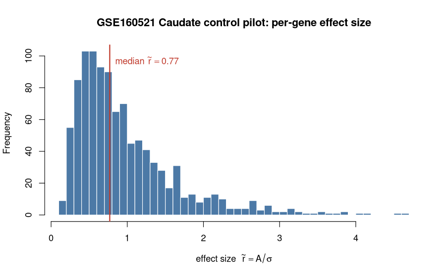
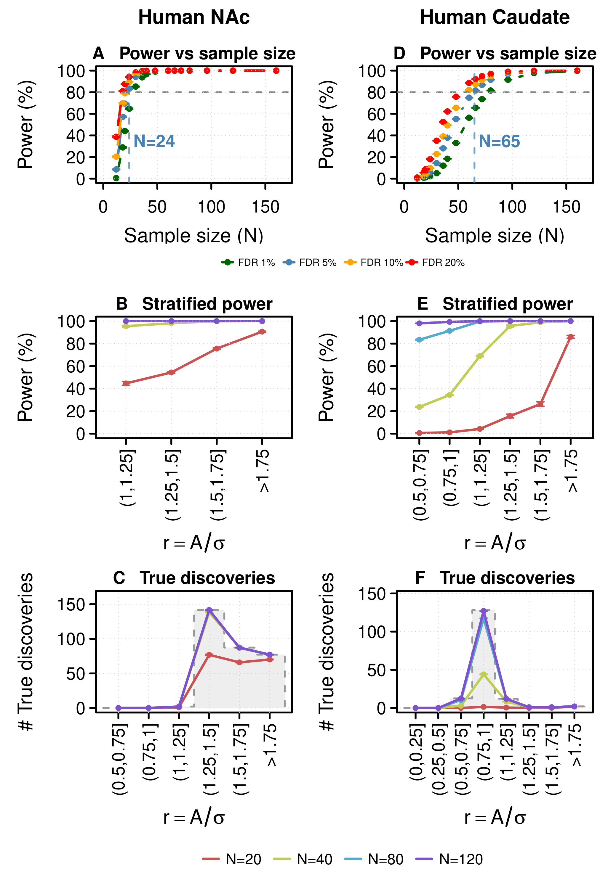
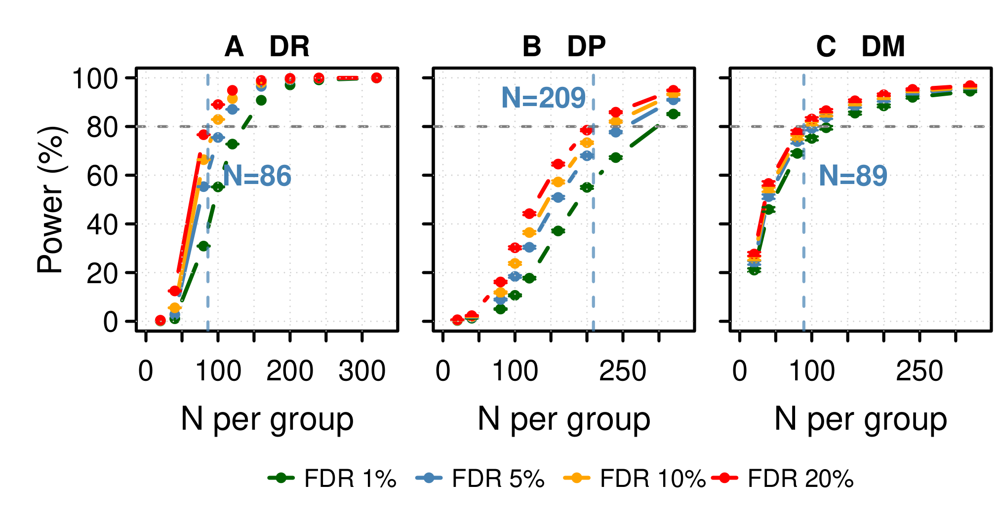
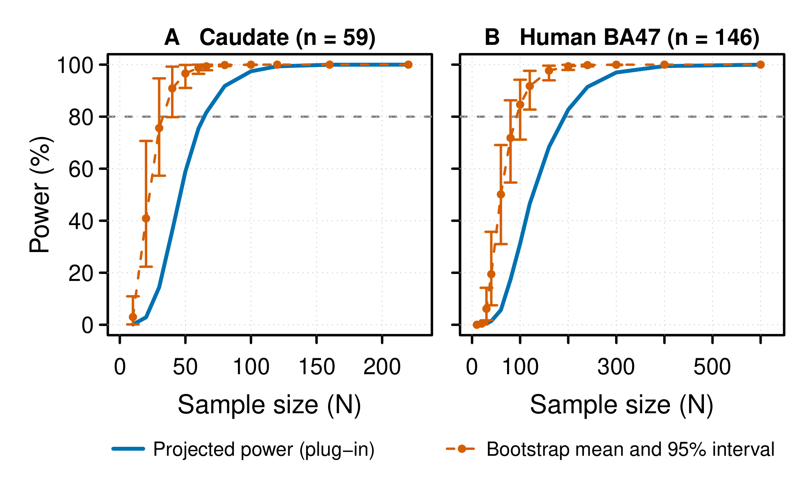
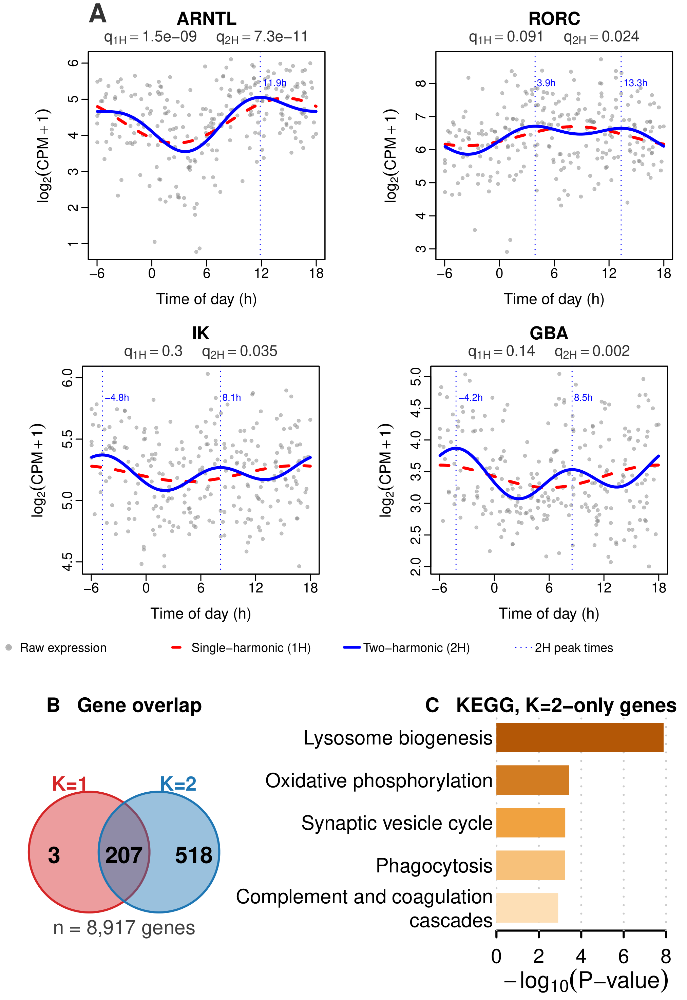
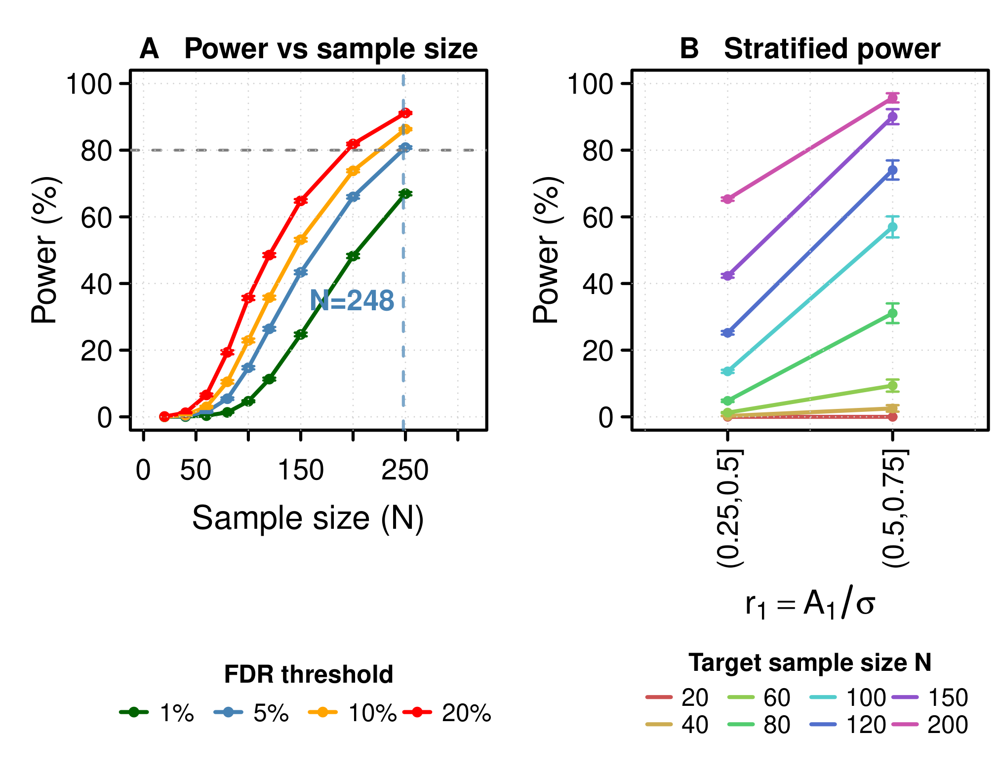
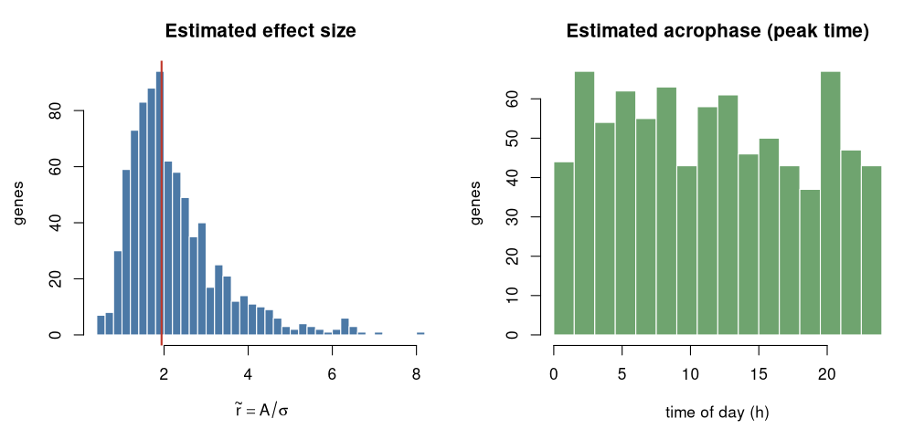
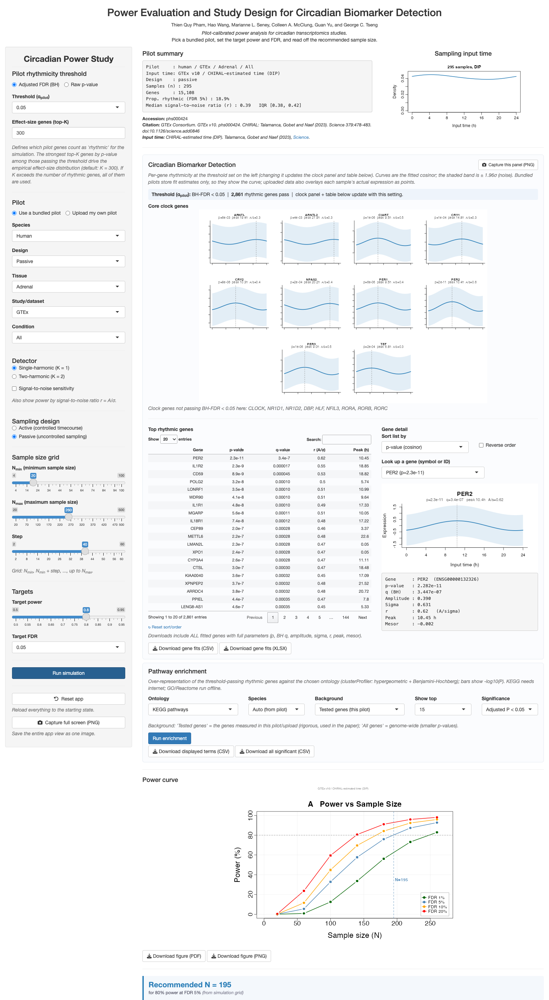

# SCP: Simulation-Based Circadian Power Analysis

[](https://opensource.org/licenses/MIT)
[](https://www.r-project.org/)

*How many samples, collected at what times of day and in which tissue, are needed to identify genes with 24-hour rhythmic expression?*

## Overview

Circadian rhythms, the approximately 24-hour oscillations that shape metabolism,
physiology, and disease, are present in only a subset of the transcriptome
([Takahashi 2017](https://doi.org/10.1038/nrg.2016.150)). Detecting those genes,
or comparing their rhythmic behavior across conditions, requires enough samples
distributed across the day to distinguish true rhythmicity from genome-wide
noise. In practice, however, circadian omics studies are often limited by sample
size. Existing methods are designed primarily for analysis after data collection:
JTK_CYCLE and RAIN detect rhythmicity within a single condition ([Hughes
2010](https://doi.org/10.1177/0748730410379711); [Thaben
2014](https://doi.org/10.1177/0748730414553029)), whereas CircaCompare and
DiffCircaPipeline compare rhythmic parameters between conditions ([Parsons
2020](https://doi.org/10.1093/bioinformatics/btz730); [Xue
2023](https://doi.org/10.1093/bioinformatics/btad039)). CircaPower provides
cosinor power calculations using a common signal-to-noise ratio and a
single-test significance threshold ([Zong
2023](https://doi.org/10.1002/sim.9803)). SCP uses the pilot distribution of
signal-to-noise ratios and simulates multiple testing across genes.

SCP answers the sample-size question by simulation, calibrated to your own data.
You give it a small *pilot* dataset (a preliminary experiment in a comparable
tissue, or one of the pilots bundled with the package), and SCP learns from
that pilot how strong each gene's rhythm is, how noisy it is, and when during the
day samples were collected, capturing the transcriptome-wide spread of effect
sizes that a single fixed value cannot. It then simulates studies of many sizes
and applies the Benjamini-Hochberg procedure at the selected level. It reports
simulated power and false discovery rate. The result is a recommended number of samples for
**circadian biomarker detection** in one group, or for **differential
rhythmicity analysis** between two groups (differences in rhythmicity, phase, or
mesor). A bootstrap layer reports how sensitive that recommendation is to the
particular pilot you started from.

A few terms used throughout, in plain language. **Power** is the chance that a
study of a given size detects a gene that truly is rhythmic. **False discovery
rate (FDR)** is the expected proportion of false discoveries among all
discoveries. SCP applies the Benjamini-Hochberg procedure at the selected level
(Benjamini and Hochberg 1995). **Signal-to-noise ratio** is written `r = A / sigma`. Larger values mean
easier detection.
**Noise (`sigma`)** is the residual standard deviation of a gene's expression
around its cosinor fit. Larger noise makes a rhythm harder to detect at the same
amplitude. **Cosinor** is the standard model that fits a cosine wave to a
gene's expression over the day ([Cornelissen
2014](https://doi.org/10.1186/1742-4682-11-16)).

## Installation

SCP is an R package. It depends on the Bioconductor package `limma`, so point
the installer at the Bioconductor repositories first.

```r
install.packages(c("remotes", "BiocManager"))
options(repos = BiocManager::repositories())   # resolves the Bioconductor dep 'limma'
options(timeout = 600)
remotes::install_github("quythien/SCP", upgrade = "never", build_vignettes = FALSE)
library(SCP)
```

To build the runnable tutorials, use `build_vignettes = TRUE` in that installation
call. You can then open them with `browseVignettes("SCP")`. This option applies
to that call and is not retained for later installations. If the GitHub download times out,
clone the repository and install from the local copy instead (`git` handles the
large download more reliably):

```r
# in a shell:  git clone https://github.com/quythien/SCP.git
options(repos = BiocManager::repositories())
remotes::install_local("SCP", upgrade = "never", build_vignettes = FALSE)
```

System requirements: R version 4.4.0 or newer and a C++ compiler (SCP uses Rcpp
and RcppArmadillo for the cosinor fit). On Linux: `apt install r-base-dev
libblas-dev liblapack-dev`. On macOS: `xcode-select --install`.

**macOS note (Fortran):** RcppArmadillo links against a Fortran and BLAS
toolchain, and CRAN R for macOS expects the official **gfortran** build. If the
install fails to compile with an error mentioning `gfortran`, `libgfortran`, or
`-lgfortran`, install the matching compiler from
<https://mac.r-project.org/tools/> (for R 4.4 on Apple Silicon or Intel this is
**gfortran 12.2-universal**, the file `gfortran-12.2-universal.pkg`), then retry
the install. This is a one time setup.

## Two ways to use SCP

**Point and click.** The bundled Shiny app runs the whole workflow in a browser
with no scripting. Install as above, then:

```r
SCP::launchShiny()
```

It runs entirely on your own machine. See the [Shiny app](#the-shiny-app)
section below for what the two halves of the app do.

**From R.** The rest of this page is the scripted API, which is what you want
for reproducible analyses.

## Quick start

Load a bundled pilot, set the study design, simulate, and read off the
recommended sample size.

SCP uses pilot expression data and sample times to estimate power under a
specified circadian model and sampling design. The bundled GTEx examples use
normalized v10 expression and season-adjusted time of death (TOD) in the
package and app. Users can also provide their own expression data and sample
times.

SCP estimates each gene's acrophase relative to the input time. The cosinor model
describes mean expression over input time. Sampling times can be evenly spaced
or unevenly distributed and do not need to follow a cosine curve.

Manuscript figures retain their original inputs. Results from the current GTEx
pilots can differ because the release, preprocessing, input time, and eligible
samples have changed.

```r
library(SCP)

# 1. Load a bundled pilot as a ready-to-use options object.
bio <- scp_load_pilot("human", "GSE160521", "Caudate", "Control")

bio$ngenes <- 1200

# 2. Describe the planned study with passive sampling from the pilot time distribution.
design   <- CircadianDesignOptions(sample_sizes = c(20, 40, 60, 80, 100, 120),
                                   nsims  = 30,
                                   design = "passive",
                                   cts    = bio$cts)
analysis <- CircadianAnalysisOptions(alpha = 0.05)

# 3. Simulate and score with the single-harmonic cosinor test (K = 1).
res <- runSimsSingleCohort(bio.opts      = bio,
                           design.opts   = design,
                           analysis.opts = analysis,
                           K             = 1,
                           mc.cores      = 4)

# 4. Smallest N reaching 80 percent power at FDR 5 percent.
npower(res, target_power = 0.80, fdr = 0.05)$n

# 5. Plot the power curve.
plotSingleCohortPower(res, fdr = 0.05)
```

## Setting up a run: the three options

Every power run combines three small settings objects. Keeping them separate lets
you change one thing at a time: the biology, the study, or the analysis.

**1. `bio` (the pilot).** What the biology looks like. Load a bundled pilot or
estimate one from your own data, then tune a field if you want.

```r
bio <- scp_load_pilot("human", "GSE160521", "Caudate", "Control")   # or estCircadianParam(expr, tod)
bio$ngenes <- 1200                                        # fewer genes = faster
```

**2. `design` (the study).** Which sample sizes to try, how many simulations, and
the sampling design. This is where the active versus passive choice lives.

```r
# active: an animal study where you control the collection times
design <- CircadianDesignOptions(sample_sizes = c(24, 48, 72, 96), nsims = 100,
                                 design = "active", cts = seq(0, 20, by = 4))

# Passive sampling draws input times from the bundled pilot distribution.
design <- CircadianDesignOptions(sample_sizes = c(50, 100, 150, 200), nsims = 100,
                                 design = "passive", cts = bio$cts)
```

**3. `analysis` (the inference).** The significance level, the multiple-testing
correction, and the FDR levels to report.

```r
analysis <- CircadianAnalysisOptions(alpha = 0.05, p.adjust.method = "BH",
                                     fdr_thresholds = c(0.05, 0.10, 0.20))
```

Then pass all three to a run function:

```r
res <- runSimsSingleCohort(bio, design, analysis, K = 1, mc.cores = 4)
```

For a bootstrap run you add a fourth object, `CircadianBootstrapOptions`; for a
two-group differential run, name the endpoints with `test_types = c("DR", "DP",
"DM")` in the design.

## Walkthrough with example outputs

The blocks below walk through the main analyses using bundled pilots. Section
(e) also shows the observed GTEx Liver comparison from the manuscript. Its
subject-level collection-time metadata are not distributed with the package.

### a. Pick a pilot

The pilots differ in how strong their rhythms are, and that is what decides how
many samples you will need. Loading a pilot and looking at its distribution of signal-to-noise ratios (`r = A / sigma`, per gene) tells you
what you are working with before you simulate anything.

```r
cau  <- readRDS(system.file("extdata", "caudate_control_GSE160521.rds", package = "SCP"))
prep <- prepCircadianData(cau$expr, cau$times, input_type = "log2")
bio  <- estCircadianParam(prep$data, prep$times, period = 24)

r_tilde <- bio$amplitude / bio$sigma_rhythmic
med     <- median(r_tilde, na.rm = TRUE)
hist(r_tilde, breaks = 40, col = "#4C79A6", border = "white",
     main = "GSE160521 Caudate control pilot: per-gene signal-to-noise ratio",
     xlab = expression("signal-to-noise ratio  " * r == A / sigma))
abline(v = med, col = "#C0392B", lwd = 2)
text(med, par("usr")[4] * 0.9, bquote(median ~ tilde(r) == .(round(med, 2))),
     col = "#C0392B", pos = 4)
```



### b. Single-cohort power

The core question for a one-group study: how many samples reach your target
power at your chosen FDR? SCP answers it two ways. The runnable examples in (b)
through (d) use control-region pilots (nucleus accumbens, caudate, and putamen)
from the public GSE160521 human striatal diurnal study ([Ketchesin
2021](https://doi.org/10.1073/pnas.2016150118)), bundled with the package; this
section loads the caudate control pilot.

```r
cau   <- readRDS(system.file("extdata", "caudate_control_GSE160521.rds", package = "SCP"))
prep  <- prepCircadianData(cau$expr, cau$times, input_type = "log2")
bio_c <- estCircadianParam(prep$data, prep$times, period = 24)
bio_c$ngenes <- 1200
```

A quick closed-form estimate comes from `circaPowerApproxN80()`, the analytical
cosinor power formula (the approach behind CircaPower, [Zong
2023](https://doi.org/10.1002/sim.9803)) evaluated at the pilot's median effect
size. It is instant and needs no simulation:

```r
circaPowerApproxN80(bio_c, alpha = 0.05, target_power = 0.80)
#> [1] 40
```

The closed form assumes one signal-to-noise ratio shared by every gene and ignores the
multiple testing across the transcriptome. The simulation drops both assumptions:
it draws the full spread of per-gene signal-to-noise ratios from the pilot and controls the
FDR across all genes at once. `runSimsSingleCohort()` runs it over a grid of
sample sizes, and `npower()` reads off the recommended N:

```r
design   <- CircadianDesignOptions(sample_sizes = c(20, 40, 60, 80, 100, 120),
                                   nsims = 30, design = "passive", cts = prep$times)
analysis <- CircadianAnalysisOptions(alpha = 0.05,
                                     fdr_thresholds = c(0.05, 0.10, 0.20))

res <- runSimsSingleCohort(bio_c, design, analysis, K = 1, mc.cores = 4)

npower(res, target_power = 0.80, fdr = 0.05)$n
```

The passive design fits this pilot: collection times in a post-mortem cohort
cannot be controlled, so SCP draws them from the pilot's own time-of-day
distribution. The manuscript compares NAc and Caudate using the full native-pilot
calibrations, 5,000 simulated genes and 600 experiments per sample size. The
interpolated recommendations are 24 and 65 samples at BH FDR 5 percent. The
[figure scripts and inputs](paper_reproduction/updated_application/README.md)
reproduce that analysis. The shorter example above illustrates the same workflow.
Draw its panels straight from the pilot:

```r
plotSingleCohortPower(bio.opts = bio_c, design.opts = design,
                      analysis.opts = analysis, K = 1, mc.cores = 4,
                      title = "GSE160521 Caudate control, passive", fdr = 0.05)
```



Panels A and D show genome-wide power against sample size at several FDR levels, with the
dashed line at the recommended N. Panels B and E break that down by signal-to-noise ratio
(`r = A / sigma`), so you can see which genes are within reach at a given N.
Panels C and F show the number of true rhythmic genes recovered in each band. Pass `panels
= "A"` for just the power curve; the legend sits in the bottom-right corner.

### c. Differential power (DR, DP, DM)

In a two-group study you often care less about the rhythms within either group
than about how those rhythms *differ* between them. SCP scores three kinds of difference:
**DR** (differential rhythmicity, a gene oscillates in one group but not the
other), **DP** (differential phase, it oscillates in both but its peak time
shifts), and **DM** (differential mesor, where the **mesor** is the rhythm
adjusted average expression level, so DM is a shift in that baseline).
`runDifferentialPower()` returns power for each, and `plotDiffPower()` draws them
side by side. Here we compare the caudate and putamen control pilots under a
passive design (times drawn from each region's own time-of-death distribution).
The two bundled matrices carry slightly different gene rosters, so match them to a
shared gene set before pairing:

```r
caudate <- readRDS(system.file("extdata", "caudate_control_GSE160521.rds", package = "SCP"))
putamen <- readRDS(system.file("extdata", "putamen_control_GSE160521.rds", package = "SCP"))
common  <- intersect(rownames(caudate$expr), rownames(putamen$expr))

bio_diff <- estCircadianParamTwoGroup(
  data_1  = caudate$expr[common, ], data_2  = putamen$expr[common, ],
  times_1 = caudate$times,          times_2 = putamen$times,
  paired_sigma = TRUE)
bio_diff$ngenes <- 3000

design_d <- CircadianDesignOptions(
  sample_sizes = c(20, 40, 60, 80, 100, 120, 160, 220), nsims = 30,
  design = "passive", cts = caudate$times, test_types = c("DR", "DP", "DM"))

res_diff <- runDifferentialPower(bio_diff, design_d,
                                 CircadianAnalysisOptions(alpha = 0.05),
                                 methods = "DCP", test_types = c("DR", "DP", "DM"),
                                 mc.cores = 4, plot = FALSE)

# Recommended N per endpoint at 80 percent power, FDR 20 percent.
sapply(c("DR", "DP", "DM"),
       function(ep) npower(res_diff, 0.80, 0.20, endpoint = ep)$n)

plotDiffPower(list(res_diff), comp_labels = "Caudate vs Putamen (GSE160521 control)",
              endpoints = c("DR", "DP", "DM"), panel_fdr = 0.05, vline_fdr = 0.20)
```



Each column is one endpoint (DR, DP, DM). Within a column, the curves show
power against per-group sample size N at four nominal BH levels (1, 5, 10,
and 20 percent). The full manuscript analysis uses the saved native-pilot
calibration, 5,000 genes and 600 experiments per sample size. Its interpolated
80 percent power recommendations at BH 20 percent are 86, 209 and 89 samples
per group. Differential phase requires the most samples in this comparison.
The [reproduction bundle](paper_reproduction/updated_application/README.md)
contains the complete power and FDP summaries. The smaller example above
illustrates fitting the bundled expression matrices.

To plan a study around a hypothesized effect instead of a real second group, set
the fractions of differing genes directly on the pilot object (`bio_diff$prop_DR`,
`$prop_DP`, `$prop_DM`) before simulating; the user guide vignette walks through
that.

### d. Bootstrap uncertainty

When the pilot itself is small, the recommended N is uncertain. SCP quantifies
that with Efron's subject bootstrap ([Efron
1979](https://doi.org/10.1214/aos/1176344552)): it resamples the pilot's subjects
with replacement many times, carrying each subject's collection time along with
its expression, and re-runs the whole estimate, so you can see how much the power
curve wobbles. `runBootstrapDesignGrid()` works from raw pilot expression, so this
example uses the caudate control pilot bundled with the package, a striatal cohort
of 59 subjects ([Ketchesin 2021](https://doi.org/10.1073/pnas.2016150118); GEO
accession GSE160521). The figure below shows the full manuscript bootstrap comparison of Caudate
and BA47. The shorter runnable example uses the bundled Caudate matrix.

```r
pilot <- readRDS(system.file("extdata", "caudate_control_GSE160521.rds",
                             package = "SCP"))
prep  <- prepCircadianData(pilot$expr, pilot$times, input_type = "log2")
bio_c <- estCircadianParam(prep$data, prep$times, period = 24)

boot_opts <- CircadianBootstrapOptions(design_vector = prep$times, B_values = 4,
                                       N_values = c(20, 40, 60, 80, 100, 120),
                                       nboot = 40, nsims_inner = 20,
                                       design = "passive", seed = 42)

boot <- runBootstrapDesignGrid(pilot_data = prep$data, pilot_times = prep$times,
                               boot.opts = boot_opts,
                               analysis.opts = CircadianAnalysisOptions(
                                 alpha = 0.05, fdr_thresholds = 0.05),
                               bio_diff.opts = bio_c, mode = "single",
                               methods = "DCP", mc.cores = 12)

plotBootstrapDesignGrid(boot, panels = "A")
```

<p align="center"></p>


The blue line is the point estimate (plug-in power). The orange dashed line
and error bars show the bootstrap mean and 95 percent interval. The manuscript
uses all 59 Caudate donors and all 146 BA47 donors, with 100 outer bootstraps
and 100 inner simulations at each sample size. BA47 has narrower intervals,
although both bootstrap mean curves remain above their plug-in curves.

### e. Two-harmonic detection (K = 2)

Not every rhythmic gene follows a simple 24-hour cosine. Many transcripts also
carry a second, 12-hour harmonic, an ultradian pattern documented across
mammalian tissues and in human liver, brain, and blood ([Hughes
2009](https://doi.org/10.1371/journal.pgen.1000442); [Zhu
2017](https://doi.org/10.1016/j.cmet.2017.05.004); [Scott
2023](https://doi.org/10.1371/journal.pbio.3001688); [Zhu
2024](https://doi.org/10.1038/s44323-024-00005-1)). A single-harmonic cosinor
test can miss these genes because their waveforms depart from a simple sinusoid.
The two-harmonic detector (`K = 2`) adds the 12-hour component and can recover
them, at the cost of two additional degrees of freedom that can reduce
power for genes that follow a single sinusoid. You enable it by setting `K = 2` in
the same run function.

The two figures below show the manuscript's GTEx Liver comparison. Liver has
substantial 12-hour structure: at FDR 5 percent, the single-harmonic test
detects 210 rhythmic genes, whereas the two-harmonic test detects 725. Several
clock and metabolic genes (ARNTL, RORC, IK, and GBA) are fit much better by the
two-harmonic model (Panel A). The two methods share 207 discoveries, while the
two-harmonic detector adds 518 genes missed by the single-harmonic detector and
loses only 3 (Panel B). That additional set is enriched for lysosome,
oxidative-phosphorylation, and complement pathways (Panel C).




For a runnable power example, load the current bundled two-harmonic Liver
pilot. Its passive sampling distribution is stored as an aggregate, so the
simulation does not require individual collection times.

```r
bio_liver <- scp_load_pilot("human", "GTEx", "Liver", "All", K = 2)
bio_liver$ngenes <- 1200

design <- CircadianDesignOptions(
  sample_sizes = c(80, 160, 240, 320, 400), nsims = 30,
  design = "passive", cts = bio_liver$time_distribution)
analysis <- CircadianAnalysisOptions(alpha = 0.05)

res_K2 <- runSimsSingleCohort(bio_liver, design, analysis, K = 2, mc.cores = 4)
npower(res_K2, target_power = 0.80, fdr = 0.05)$n
```



The second figure shows the supplementary two-harmonic framework analysis. Panel A
plots genome-wide power against `N` at several FDR levels, and Panel B
stratifies power by first-harmonic signal-to-noise ratio. Its fixed calibration
gives N80 = 248 and is separate from the matched comparison below.

A separate matched comparison applied both detectors to each simulated dataset
from the same two-harmonic Liver calibration, with 5,000 genes and 600
experiments per sample size. This holds the rhythmic gene population and
waveform distribution fixed. At BH FDR 5%, the interpolated N80 values
returned by the `npower()` rounding rule were:

| Sampling design | K = 1 | K = 2 |
|---|---:|---:|
| Passive | 283 | 253 |
| Balanced, six time points | 278 | 249 |

The tested brackets were 264-288 for `K = 1` and 240-264 for `K = 2` under
both designs. `npower()` rounds the linear crossing up to an integer. A
balanced six-time-point experiment further requires a multiple of six, giving
282 and 252 samples for the two detectors. These interpolated values are
distinct from the tested grid points. Balanced sampling gave a modest
reduction in this comparison.

The two-harmonic model requires at least 5 distinct sampling times per day to
be identifiable (`K = 1` requires 3). It is most appropriate when the pilot or
prior biology suggests non-sinusoidal structure and the sampling grid is
sufficiently dense.


### f. Use your own pilot

In practice you start from your own data: a gene by sample expression matrix and
a vector of collection times in hours. `prepCircadianData()` cleans and aligns
the inputs, and `estCircadianParam()` learns the pilot's rhythm parameters. Two
of those parameters are shown below: the per-gene signal-to-noise ratio, and the
**acrophase** (the time of day at which each gene peaks). For a two-group pilot,
use `estCircadianParamTwoGroup()` instead.

```r
expr <- as.matrix(read.csv(
  system.file("extdata/example/example_expression.csv", package = "SCP"),
  row.names = 1, check.names = FALSE))
tod <- scan(system.file("extdata/example/example_tod.csv", package = "SCP"),
            what = double())

prep    <- prepCircadianData(expr, tod, input_type = "log2")
bio_own <- estCircadianParam(expr, tod, period = 24)

r_own <- bio_own$amplitude / bio_own$sigma_rhythmic
phase <- bio_own$phase %% bio_own$period

par(mfrow = c(1, 2))
hist(r_own, breaks = 35, col = "#4C79A6", border = "white",
     main = "Estimated signal-to-noise ratio", xlab = expression(r == A / sigma))
hist(phase, breaks = seq(0, 24, by = 1.5), col = "#6FA46F", border = "white",
     main = "Estimated acrophase (peak time)", xlab = "time of day (h)")
```



`bio_own` now plugs into `runSimsSingleCohort()` exactly like a bundled pilot.
The shipped example is simulated data (designed to resemble a GTEx Adrenal pilot
so it is freely shareable); swap in your own `expr` and `tod` and nothing else
changes.

## The Shiny app

`launchShiny()` opens a browser app with two linked panels.

**Circadian Power Study** (left) is the sample-size calculator. Cascading
dropdowns pick a pilot (species, then dataset, then tissue, then condition), and
you set a rhythmicity threshold, the sampling design (active timecourse or
passive input-time sampling), a grid of sample sizes, and sliders for target power and
FDR. Clicking *Run simulation* draws the power curve and the recommended sample
size. On launch the app opens on the GSE160521 Caudate control (passive) pilot.



The example uses Brain Cortex with a pilot threshold of BH FDR 5%.

**Circadian Biomarker Detection** (right) explores the pilot itself: a core
clock-gene cosinor panel, a ranked table of rhythmic genes with their FDR
adjusted p-values and signal-to-noise ratios, a per-gene cosinor fit, and pathway
enrichment (KEGG, Reactome, GO). The bundled pilots are available, and you
can also upload your own pilot (an expression-matrix CSV and a one-column
time-of-day CSV) and get the same analyses on your data. An example pair of
upload files ships with the package:

```r
system.file("extdata/example/example_expression.csv", package = "SCP")
system.file("extdata/example/example_tod.csv",        package = "SCP")
```

## Pilot database

SCP includes circadian transcriptomic pilots across human, baboon, mouse, and
rat. Three accessors browse and load them. The package and app use v10
**season-adjusted time of death (TOD)** pilots for GTEx.

| Function | Use |
|---|---|
| `scp_pilots()` | List default pilots, including v10 TOD for GTEx |
| `scp_pilot_search(query, species, tissue_pattern)` | Search the default pilots |
| `scp_load_pilot(species, dataset, tissue, condition)` | Load one pilot as a `CircadianBioOptions` object |

```r
scp_pilots()                                             # default pilots
scp_pilot_search(species = "human", tissue_pattern = "caudate")
bio <- scp_load_pilot("human", "GSE160521", "Caudate", "Control")

```

The current GTEx summary is
[`summary/gtex_v10_signal_summary.csv`](summary/gtex_v10_signal_summary.csv).
It records the input time, sample and gene counts, signal strength, and BH discovery
counts for 46 tissues. The current catalogue summary,
[`summary/tissue_signal_summary.csv`](summary/tissue_signal_summary.csv),
covers all 160 bundled pilots: 46 GTEx v10 TOD and 114 pilots from other studies.
It reports paired signal-to-noise ratios for up to 300 genes ranked by raw
single-harmonic p-values below 0.01. The rhythmic proportion uses every gene
passing that screen divided by the full tested gene count. GTEx empirical
time summaries are unavailable because these pilots store aggregate time
distributions. [Pilots used in the application figures](summary/application_pilot_summary.csv)
are summarized separately, including the full 146-donor BA47 input. The earlier paper tables remain in
[`paper_reproduction/Supplement/Tables`](paper_reproduction/Supplement/Tables).

## Documentation

- Runnable tutorial: `browseVignettes("SCP")`, then open "Getting started with
  SCP", or the fuller "User Guide".
- Function reference: `?SCP`, or `help(package = "SCP")`, or the bundled
  `SCP-manual.pdf`.
- News and release notes: `NEWS.md`.
- Current figure code and plotting data: [updated application](paper_reproduction/updated_application/README.md).
- Earlier paper inputs: [paper_reproduction/](paper_reproduction/README.md).

## References

- Benjamini Y, Hochberg Y. 1995. Controlling the false discovery rate: a practical and powerful approach to multiple testing. *Journal of the Royal Statistical Society: Series B* 57:289-300.
- Cornelissen G. 2014. Cosinor-based rhythmometry. *Theoretical Biology and Medical Modelling* 11:16. https://doi.org/10.1186/1742-4682-11-16
- Efron B. 1979. Bootstrap methods: another look at the jackknife. *Annals of Statistics* 7:1-26. https://doi.org/10.1214/aos/1176344552
- GTEx Consortium. 2020. The GTEx Consortium atlas of genetic regulatory effects across human tissues. *Science* 369:1318-1330. https://doi.org/10.1126/science.aaz1776
- Hughes ME, DiTacchio L, Hayes KR, et al. 2009. Harmonics of circadian gene transcription in mammals. *PLoS Genetics* 5:e1000442. https://doi.org/10.1371/journal.pgen.1000442
- Hughes ME, Hogenesch JB, Kornacker K. 2010. JTK_CYCLE: an efficient nonparametric algorithm for detecting rhythmic components in genome-scale data sets. *Journal of Biological Rhythms* 25:372-380. https://doi.org/10.1177/0748730410379711
- Ketchesin KD, Zong W, Hildebrand MA, et al. 2021. Diurnal rhythms across the human dorsal and ventral striatum. *Proceedings of the National Academy of Sciences* 118:e2016150118. https://doi.org/10.1073/pnas.2016150118
- Parsons R, Parsons R, Garner N, Oster H, Rawashdeh O. 2020. CircaCompare: a method to estimate and statistically support differences in mesor, amplitude and phase, between circadian rhythms. *Bioinformatics* 36:1208-1212. https://doi.org/10.1093/bioinformatics/btz730
- Scott MR, Zong W, Ketchesin KD, et al. 2023. Twelve-hour rhythms in transcript expression within the human dorsolateral prefrontal cortex are altered in schizophrenia. *PLoS Biology* 21:e3001688. https://doi.org/10.1371/journal.pbio.3001688
- Takahashi JS. 2017. Transcriptional architecture of the mammalian circadian clock. *Nature Reviews Genetics* 18:164-179. https://doi.org/10.1038/nrg.2016.150
- Talamanca L, Gobet C, Naef F. 2023. Sex-dimorphic and age-dependent organization of 24-hour gene expression rhythms in humans. *Science* 379:478-483. https://doi.org/10.1126/science.add0846
- Thaben PF, Westermark PO. 2014. Detecting rhythms in time series with RAIN. *Journal of Biological Rhythms* 29:391-400. https://doi.org/10.1177/0748730414553029
- Xue X, Zong W, Huo Z, et al. 2023. DiffCircaPipeline: a framework for multifaceted characterization of differential rhythmicity. *Bioinformatics* 39:btad039. https://doi.org/10.1093/bioinformatics/btad039
- Zhu B, Zhang Q, Pan Y, et al. 2017. A cell-autonomous mammalian 12 hr clock coordinates metabolic and stress rhythms. *Cell Metabolism* 25:1305-1319. https://doi.org/10.1016/j.cmet.2017.05.004
- Zhu B, Liu S, David NL, et al. 2024. Evidence for conservation of primordial 12-hour ultradian gene programs in humans under free-living conditions. *npj Biology of Timing and Sleep* 2:5. https://doi.org/10.1038/s44323-024-00005-1
- Zong W, Seney ML, Ketchesin KD, et al. 2023. Experimental design and power calculation in omics circadian rhythmicity detection using the cosinor model. *Statistics in Medicine* 42:3236-3258. https://doi.org/10.1002/sim.9803

## GTEx pilot sources

The active GTEx pilots use normalized v10 expression with season-adjusted
TOD. Within each tissue, TMM normalization and log-CPM calculation follow the
normalization step of [Talamanca et al.
(2023)](https://doi.org/10.1126/science.add0846). The builder retains samples
with valid TOD, keeps the first gene for each symbol, and selects genes with
mean log-CPM greater than 3. Cosinor models are fitted to the normalized
expression.

The manifest records the release, input-time basis, source recipe, and cohort
counts. The [v10 builders](examples/pilots/gtex_v10/README.md) document the
numbered steps, preprocessing, and source settings.

The earlier DIP analysis and its [full expression and DIP archive](https://github.com/quythien/SCP/releases/download/v0.5.0/GTEx_v10_full_DIP.tar)
remain available from SCP 0.5.0 for research. The archive contains
covariate-adjusted log-CPM residuals and CHIRAL-estimated DIP for 46 tissues.

Earlier package versions are available under [GitHub releases](https://github.com/quythien/SCP/releases).

## Citation

If you use SCP in your research, please cite:

```
Pham, T. Q. (2026). SCP: Simulation-Based Circadian Power Analysis.
  R package, latest version at https://github.com/quythien/SCP
```

Use `citation("SCP")` for the software and source references. A `CITATION.cff`
is also provided on GitHub.

## License

Package code is distributed under the MIT license. See `LICENSE`.
GTEx data follow the [GTEx Portal Data License](https://gtexportal.org/home/license).

## Contact

Issues and feature requests: <https://github.com/quythien/SCP/issues>
